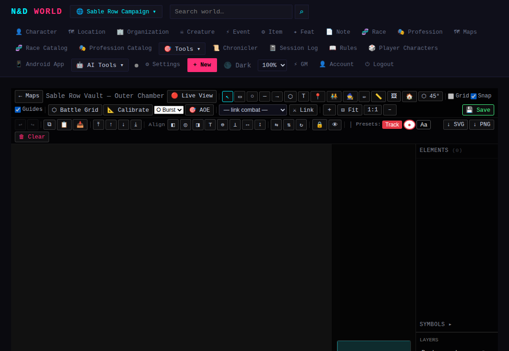

# Maps & Schematics

*Applies to: GM (creating/editing) and Players (viewing, and — on
schematics — moving their own token, buying, picking up items).*

Maps and schematics appear together in the Maps collection, with the same
folder and layout controls. A GM opening a map from that page enters the Map
Maker workspace; its Existing map picker can open either kind there. Switching
back to Map Maker keeps its drawing studio open. Existing maps use their
original editors and data; they are not automatically imported into the drawing studio.
**Copy to Map Maker** creates a separate project with the background image, if
any, as a paintable underlay (HTML schematics cannot be copied). Image-map pins and regions
are copied too, including custom pin notes and schematic links; schematic floor
groups, walls, lights, visible pins, visible token markers and floor links are copied. Solid lines and
pencil paths become paint strokes; width, ends and stacking can differ. Floor links navigate
the editor; character travel still uses the original. Hidden elements, dashed lines, entity
links, other schematic elements, tokens, fog and other gameplay data remain in the original;
changes to either copy are independent. Opening the copied project selects its
original in the workspace so its editor can be reopened quickly. Deleting the
original or the project removes that link, not the other copy.
For GMs, the top-level collection also lists Map Maker projects, which are
shared across worlds. Publishing a project again can replace manually edited
elements and tokens in its published schematic. Full Backup does not include
the Map Maker project folder (`<data>/cartographer/data`); back it up separately.

To play a Map Maker floor, finish editing and choose **Create playable copy
of current floor**. This creates a new schematic using the player-filtered
picture, walls and lights; it never replaces an existing map. Inspect the
picture before sharing it: painted details and visible markers are baked into
it. Secret doors become ordinary walls in the copy. Add tokens, fog, combat
and floor travel in its schematic editor. **Refresh playable copy artwork**
replaces only the linked copy's picture: walls, lights, tokens, fog and other
gameplay data remain unchanged, and Map Maker wall and light edits are not
applied. It refuses to refresh if the copy's background, size or grid has
changed, or if the new export has different dimensions. A floor has at most one
linked playable copy per world. Deleting the project or schematic removes that
link, not the other item.

**Refresh playable walls and lights** separately replaces those with the
player-filtered Map Maker geometry, only if the playable copy's walls and lights
still match their last imported state and its artwork matches the project.
If either was changed during play, it refuses rather than overwriting the
changes. Update them by hand instead. Copies made before this safeguard have no
recorded baseline and cannot use this action. Tokens, fog and other gameplay
data remain unchanged.

For a multi-floor project, **Create linked playable floors** prepares a copy of
each floor and adds the Map Maker stairs as character-travel links between
them. Existing playable copies must have matching artwork; refresh an out-of-date
copy first. This groups the copies, not the original maps. If preparation fails,
copies already made remain in Maps; inspect them before retrying. Later edits to
stairs, walls or lights do not automatically update the playable floors.

## Maps — image-based, with markers and regions

**🗺 Maps → + New Map**, upload a background image (a world map, city plan,
whatever). On the viewer, the GM can drop **markers** (pins linked to
entities, or freeform) and draw **region overlays**. Players see the same
map read-only, filtered to whatever the GM has chosen to show.

## Schematics — SVG battle-map / dungeon editor

**Schematics** are a full canvas editor for tactical layouts — think a
simple VTT built in. From the GM editor (`/maps/schematic/{slug}`) you can:

- Draw shapes, place labels, and drop **tokens** (linked to `PlayerCharacter`
  or `Entity` rows, or freeform).
- Set a **grid overlay** — none, square, or hex (pointy or flat orientation),
  with configurable cell size/offset.
- **Embed images** directly into elements via the 🖼 tool (no separate
  upload round trip).
- **Link the schematic to a Combat Tracker session** — 🔗 Link Combat, then:
  - **Pull from Combat** creates/refreshes a token for every combatant.
  - **Push to Combat** writes token HP/max HP/conditions back onto the
    linked combat's combatants.
  This keeps the visual battle map and the numeric initiative tracker in
  sync without hand-copying HP totals back and forth.

## The player view

Players reach a schematic through its **player view** (a live,
auto-updating read version that hides GM-only elements). A non-GM player may:

- **Move only their own token** — the one linked to their `PlayerCharacter`.
- **Pick up an item-token stack** into their character's inventory.
- **Buy from a merchant token** — one stock row at a time; currency and
  stock are deducted and locked against concurrent purchases, so two players
  buying the last potion at once can't both succeed.

## Deleting and renaming

Both maps and schematics can be renamed or deleted from their list pages —
deletion removes the associated uploaded image(s) too.

---

## Quick example: a blank schematic

**🗺 Maps → + New Schematic**, give it a name (and, optionally, a starting
canvas size/background) — you land straight in the editor on a blank canvas,
ready for shapes, tokens, a grid overlay, and the combat-link toolbar along
the top.

Draw the room, drop tokens for your NPCs (linked to their Entity rows so
clicking one jumps to their sheet), set a grid, and — once you're running
the encounter — **🔗 Link Combat** to keep this canvas and the Combat Tracker
in sync.
